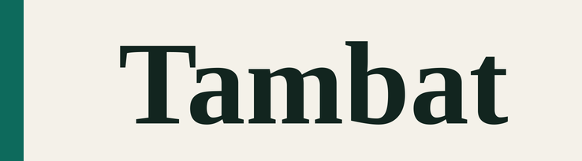
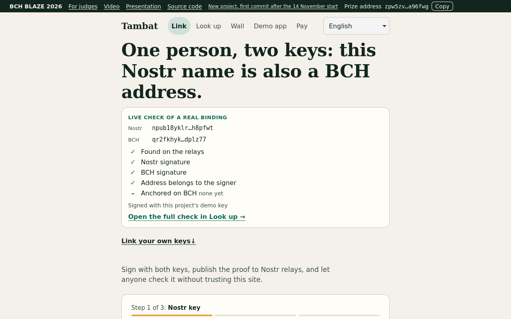
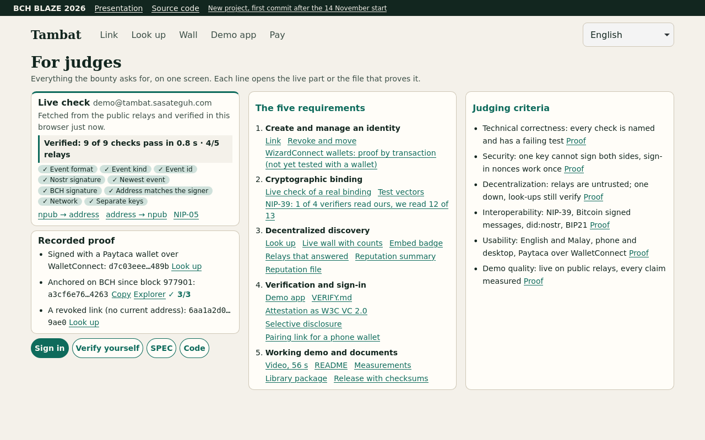

<h1 align="center"></h1>

<p align="center"><a href="LICENSE"></a> <a href="https://tambat.sasateguh.com"></a> <a href="https://tambat.sasateguh.com/judges"></a> <a href="docs/NIP-39-bch.md"></a></p>

<p align="center"><b>Satu orang, dua kunci: ikat alamat Bitcoin Cash kepada kunci Nostr, dan biar sesiapa pun menyemaknya tanpa mempercayai pelayan.</b> · <i>One person, two keys: bind a Bitcoin Cash address to a Nostr key, and let anyone check it without trusting a server.</i><br>
<a href="https://tambat.sasateguh.com"><b>demo hidup</b></a> · <a href="https://tambat.sasateguh.com/judges"><b>Menilai? Mula di sini</b></a> · <a href="#cuba-dalam-60-saat">Cuba</a> · <a href="#jalankan-sendiri">Jalankan</a> · <a href="#ujian">Ujian</a> · <a href="#had">Had</a> · <a href="README.md">English</a><br>
Dibina di Malaysia oleh <a href="https://aimanmalib.com">Aiman Malib</a> · <a href="https://sasateguh.com">Sasa Teguh</a></p>

Ini ringkasan Bahasa Melayu bagi [README.md](README.md). Spesifikasi, model ancaman dan setiap ukuran ada dalam versi
Inggeris dan `docs/`; jika kedua-duanya berbeza, versi Inggeris yang terpakai.

Dibina untuk BCH BLAZE 2026, ganjaran "Decentralized Identity". Projek baharu: komit pertama selepas acara bermula pada
14 November ([komit pertama](https://github.com/aimanmalib/tambat/commit/988ff7db24092061477503a63fe28fcbb866b92c)).
Laman ini dalam bahasa Inggeris dan Melayu: https://tambat.sasateguh.com

Alamat hadiah dan undian EMBER2026 entri ini: `bitcoincash:zpw5zvrmw73eyakw92z98gccxnrhvrhuvypka96fwg`.



## Apa ia

Seseorang membuktikan bahawa satu kunci Bitcoin Cash dan satu kunci Nostr miliknya dengan menandatangani setiap satu
sambil merujuk yang lain:

- kunci BCH menandatangani teks NIP-39 `Verifying that I control the following Nostr public key: <npub>`;
- kunci Nostr menandatangani acara identiti NIP-39 (kind `10011`) yang membawa alamat itu dan tandatangan tadi.

Acara itu dihantar ke relay Nostr awam biasa. Sesiapa boleh mencarinya dari npub atau dari alamat dan menyemak kedua-dua
tandatangan sendiri. Aplikasi boleh memakai ikatan itu: menunjukkan alamat pembayaran yang disahkan untuk satu npub,
log masuk pengguna dengan kunci Nostr dan membaca alamat BCH mereka, atau menerbitkan dokumen `did:nostr`.

Bahagian projek: `src/core/` (pustaka), `bin/tambat.ts` (pengesah baris arahan tanpa pelayan kami), `server/` (pelayan
aplikasi kecil: log masuk, dokumen DID) dan `web/` (aplikasi web).

## Cuba dalam 60 saat

1. Buka https://tambat.sasateguh.com. Kad pertama ialah ikatan sebenar; pelayar menyemak tandatangan Nostr, tandatangan
   BCH, bahawa penandatangan memiliki alamat itu, kemudian komitmen BCH. Setiap tanda muncul hanya bila semakannya selesai.
2. **Link**: sambung kunci Nostr (sambungan NIP-07, penandatangan jauh NIP-46, atau kunci demo), kemudian kunci BCH
   (Paytaca melalui WalletConnect, dompet WizardConnect, tandatangan yang ditampal dari mana-mana dompet, atau kunci demo).
   Halaman menjalankan setiap langkah pengesahan sebelum menerbitkan ke relay awam, dan menunjukkan relay mana yang menerimanya.
3. **Look up**: tampal npub, alamat atau nama NIP-05 seperti `demo@tambat.sasateguh.com`. Pelayar bertanya kepada relay dan
   mengesahkan hasilnya sendiri. **Try tampering** mengubah satu medan salinan tempatan dan menunjukkan langkah yang menangkapnya.
4. **Pay**: npub atau nama NIP-05 menjadi alamat yang disahkan, pautan BIP21 dan kod QR. Dompet anda sendiri yang menghantar.
5. **Demo app**: log masuk dengan Nostr, atau dengan dompet BCH sahaja; pelayan menyemak cabaran yang ditandatangani dan mencari
   ikatan di relay sendiri.



## Jalankan sendiri

Node 22, npm.

```
npm ci
npm run build && npm start     # aplikasi web dan pelayan log masuk
npx tsx bin/tambat.ts verify examples/binding-event.json   # semak satu ikatan luar talian
npx tsx bin/tambat.ts lookup <npub|bitcoincash:...>        # cari dan semak di relay
```

## Ujian

```
npm test
npm run build && npm run e2e   # Chromium desktop dan WebKit iPhone 13
npm run gate                   # lint, jenis, ujian unit, binaan, ujian hujung ke hujung
```

Ujian hujung ke hujung menjalankan pelayan sebenar terhadap relay dalam memori, dan menyemak kebolehcapaian (axe, WCAG
2.1 AA), ralat konsol dan limpahan mendatar pada 320 px. Vektor ujian dari luar projek (BIP-340, spesifikasi CashAddr,
mesej bertandatangan Electron Cash) turut lulus.

## Had

- **Paytaca melalui WalletConnect** telah digunakan sekali dengan dompet Paytaca sebenar (dalam `docs/MEASURED.md`); rangkaian
  relay WalletConnect dan dompet telefon sebenar tidak diliputi ujian automatik.
- **Pemulihan** meliputi kunci Nostr yang hilang, bukan yang dicuri; menerbitkan pemulihan ialah arahan CLI.
- **Satu alamat bagi setiap kunci Nostr**, P2PKH sahaja.
- **Identiti**: ikatan menyatakan dua kunci milik bersama, bukan siapa orangnya.
- **Privasi**: ikatan sengaja awam dan memautkan alamat pembayaran kepada identiti sosial. Gunakan alamat berasingan jika
  mahu pembayaran yang tidak boleh dipautkan.
- **Sauh BCH pilihan**: hanya satu sauh wujud, untuk ikatan Paytaca, dibuat oleh pemiliknya. Kunci demo tiada sauh; satu-satunya
  rekodnya di rantaian ialah transaksi bukti WizardConnect di bawah, dibayar dengan amaun ujian kecil yang dihantar ke alamat demo.
- **Dompet WizardConnect** menandatangani transaksi bukti. Diuji dengan Cashonize v0.15.2 melalui WizardConnect di mainnet
  (blok 978362): satu transaksi bukti, ikatan di relay yang disahkan oleh Look up, dan halaman mengesan bila dompet memutuskan
  sambungan ([ukuran](docs/MEASURED.md#third-party-wallet-over-wizardconnect)). Ini satu dompet; dompet WizardConnect lain
  belum dicuba.
- **Bukti di rantaian** (`tx:<txid>`) lulus semasa transaksinya masih dalam mempool, jadi sebelum ia masuk blok penghantar
  boleh menggantikannya dengan belanja berganda. Pengesah satu fail dan log masuk pelayan tidak membaca rantaian, jadi di
  situ bukti begini dipapar sebagai tidak disemak.
- **Pengesah NIP-39 lain**: dua daripada empat yang diukur membaca bukti di rantaian ikatan demo; tiada yang membaca ikatan
  Paytaca, yang ditulis dalam bentuk lama ([ukuran](docs/MEASURED.md#interoperability)).
- Senarai penuh: [README.md](README.md#known-limits-and-next-steps).

## Pendedahan AI

Kod dan dokumen dalam repositori ini ditulis oleh ejen pengekodan AI. Pemilik memilih masalah, menetapkan skop dan
menyemak kerja itu.

## Lesen

MIT. Lihat [LICENSE](LICENSE).

## Bekerja dengan Sasa Teguh

Saya membina projek ini. Saya menjalankan [Sasa Teguh](https://sasateguh.com), sebuah studio di Malaysia yang membina laman web
yang ditemui di Google dan dalam jawapan AI, serta menyediakan sistem seperti ini untuk perniagaan.

[Tempah panggilan](https://sasateguh.com/book) · hello@sasateguh.com · [Lagi dari Sasa Teguh](https://github.com/sasateguh)
